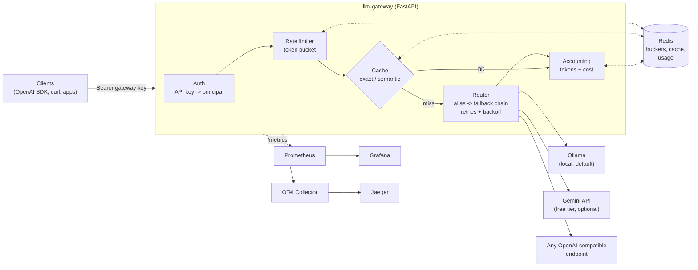
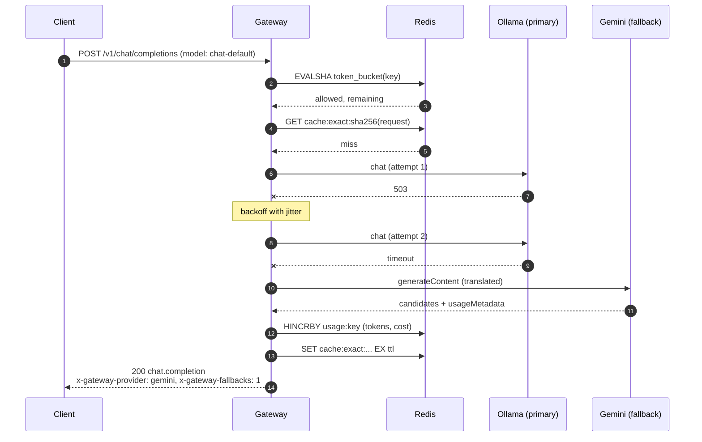

# llm-gateway

[](https://github.com/ajmalmansuri02/llm-gateway/actions/workflows/ci.yml)


A small, self-hosted LLM gateway: one **OpenAI-compatible API** in front of local
and hosted model providers, with routing, fallback, retries, rate limiting,
caching, cost accounting and full observability.

> **This is a learning project.** I'm a backend engineer (Python/FastAPI, GCP)
> working through the infrastructure side of AI engineering. I built this to
> understand how gateways like LiteLLM, Portkey, Kong AI Gateway or Envoy AI
> Gateway work by writing one myself. It is tested and runs end to end, but it
> has not been hardened for production. If you need a gateway for real traffic,
> use one of those projects.

Everything runs locally for free: [Ollama](https://ollama.com) is the default
provider, the Gemini free tier is optional, and any OpenAI-compatible endpoint
(vLLM, llama.cpp server, LM Studio, a hosted API) can be added in config.

---

## Contents

- [Why gateways exist](#why-gateways-exist)
- [Features](#features)
- [Architecture](#architecture)
- [Quickstart](#quickstart)
- [Using the API](#using-the-api)
- [Configuration reference](#configuration-reference)
- [Observability](#observability)
- [Load testing](#load-testing)
- [Development](#development)
- [Design notes and trade-offs](#design-notes-and-trade-offs)
- [Roadmap](#roadmap)
- [What I learned](#what-i-learned)

## Why gateways exist

Once more than one service in a company calls LLMs, the same concerns appear in
every codebase:

| Concern | Without a gateway | With a gateway |
| --- | --- | --- |
| **Provider lock-in** | Each app hard-codes one SDK and model | Apps call a stable alias (`chat-default`); the routing table decides what serves it |
| **Reliability** | Every app writes its own retry loop, or doesn't | Retries with backoff and a fallback chain in one place |
| **Cost control** | Spend shows up on the monthly invoice | Per-key token and cost accounting, rate limits, caching |
| **Security** | Provider keys copied into every service | Provider keys live in the gateway; apps get revocable gateway keys |
| **Compliance** | Prompts logged inconsistently, PII and all | One logging path with redaction |
| **Visibility** | "Is the model slow, or is it us?" | Latency, time to first token, errors, tokens and cache hits per provider |

A gateway is a reverse proxy that understands the LLM protocol: it can read the
prompt, count tokens, cache answers and pick a different upstream.

## Features

- **OpenAI-compatible API**: `POST /v1/chat/completions` (streaming over SSE and non-streaming), `POST /v1/embeddings`, `GET /v1/models`. Existing OpenAI SDKs work by changing `base_url`.
- **Providers**: any OpenAI-compatible server (Ollama's `/v1` included), native Google Gemini (`generateContent` / `streamGenerateContent` / `batchEmbedContents`, translated to and from the OpenAI format), and an in-process fake for tests and load tests.
- **Config-driven routing**: aliases map to ordered fallback chains of `provider/model` targets. `provider/model` can also be called directly.
- **Retries and fallback**: exponential backoff with jitter for transient errors (timeouts, connection errors, 429, 500/502/503/504); falls back to the next target on failure; returns client errors (400/413/422) at once. Streams fall back only before the first byte reaches the client.
- **Per-key rate limiting**: token bucket in Redis, run as one atomic Lua script so replicas share limits. Returns `429` with `Retry-After`.
- **Caching**: exact-match response cache, plus an opt-in **semantic cache** (embedding similarity) per alias. Both live in Redis with a TTL.
- **Token and cost accounting**: per API key and per model, priced from a configurable table (local models cost zero). `GET /v1/usage` shows the caller's totals.
- **Logging**: structured JSON logs; prompt and completion bodies are off by default, and **PII is redacted** when they are on (emails, cards with a Luhn check, phone numbers, SSN, Aadhaar, PAN, IPs, API keys).
- **Health**: `/healthz` (liveness) and `/readyz` (checks Redis).
- **Metrics**: Prometheus histograms and counters for latency, time to first token, tokens, cost, cache lookups, provider errors, fallbacks and rate-limit rejections.
- **Tracing**: OpenTelemetry spans for the request, the gateway pipeline and every provider attempt, exported over OTLP to a collector and on to Jaeger.
- **Local stack**: docker-compose with gateway, Redis, Ollama, Prometheus, Grafana (provisioned dashboard), an OTel collector and Jaeger. A k6 load test is included.

## Architecture



A non-streaming request, with the primary provider failing:



### Code map

| Module | Responsibility |
| --- | --- |
| [`app.py`](src/llm_gateway/app.py) | FastAPI wiring, middleware, HTTP endpoints, error envelope |
| [`service.py`](src/llm_gateway/service.py) | The pipeline: cache -> route -> account -> store; streaming assembly |
| [`routing.py`](src/llm_gateway/routing.py) | Alias resolution, retries with backoff, fallback chain, stream start |
| [`providers/`](src/llm_gateway/providers) | `openai_compat`, `gemini` (wire-format translation), `fake` |
| [`ratelimit.py`](src/llm_gateway/ratelimit.py) | Redis token bucket in Lua |
| [`cache.py`](src/llm_gateway/cache.py) | Exact and semantic caches |
| [`accounting.py`](src/llm_gateway/accounting.py) | Usage and cost per key |
| [`redaction.py`](src/llm_gateway/redaction.py) | PII redaction for logs |
| [`metrics.py`](src/llm_gateway/metrics.py), [`tracing.py`](src/llm_gateway/tracing.py), [`logging_setup.py`](src/llm_gateway/logging_setup.py) | Observability |
| [`config.py`](src/llm_gateway/config.py) | Env settings and the YAML routing config |

## Quickstart

### Option A: full stack with Docker Compose

```bash
git clone https://github.com/ajmalmansuri02/llm-gateway.git
cd llm-gateway
cp .env.example .env              # optional: add GEMINI_API_KEY for the fallback

docker compose up -d --build
docker compose run --rm ollama-pull   # first run only: pulls a small chat model and an embedding model
```

| Service | URL |
| --- | --- |
| Gateway | http://localhost:8080 (OpenAPI docs at `/docs`) |
| Grafana | http://localhost:3000 (dashboard "LLM Gateway"; anonymous view, `admin`/`admin` to edit) |
| Prometheus | http://localhost:9090 |
| Jaeger | http://localhost:16686 |

For an NVIDIA GPU, uncomment the `deploy` block on the `ollama` service. On
macOS, running Ollama natively and pointing `OLLAMA_BASE_URL` at
`http://host.docker.internal:11434/v1` is much faster than running it in Docker.

### Option B: just the gateway, on the host

```bash
python -m venv .venv && source .venv/bin/activate
pip install -e ".[dev]"

# memory:// uses an in-process fake Redis (from the dev extras): no Redis needed.
REDIS_URL=memory:// LOG_JSON=false make run
```

With `ollama serve` running locally, `chat-default` and `chat-local` work at once.
The `demo-echo` alias needs no model at all.

### Try it

```bash
export GW=http://localhost:8080 KEY=sk-gw-dev-local-only

# Non-streaming
curl -s $GW/v1/chat/completions -H "Authorization: Bearer $KEY" -H 'Content-Type: application/json' \
  -d '{"model":"chat-default","messages":[{"role":"user","content":"Why do LLM gateways exist? One sentence."}]}' | jq

# Streaming (SSE)
curl -N $GW/v1/chat/completions -H "Authorization: Bearer $KEY" -H 'Content-Type: application/json' \
  -d '{"model":"chat-default","stream":true,"stream_options":{"include_usage":true},
       "messages":[{"role":"user","content":"Count to five."}]}'

# Embeddings
curl -s $GW/v1/embeddings -H "Authorization: Bearer $KEY" -H 'Content-Type: application/json' \
  -d '{"model":"embed-default","input":["hello","world"]}' | jq '.data[].embedding | length'

# What has this key used?
curl -s $GW/v1/usage -H "Authorization: Bearer $KEY" | jq
```

With the official OpenAI Python SDK:

```python
from openai import OpenAI

client = OpenAI(base_url="http://localhost:8080/v1", api_key="sk-gw-dev-local-only")

stream = client.chat.completions.create(
    model="chat-default",
    messages=[{"role": "user", "content": "Explain token buckets in two sentences."}],
    stream=True,
)
for chunk in stream:
    if chunk.choices:
        print(chunk.choices[0].delta.content or "", end="", flush=True)
```

### Adding Gemini (free tier)

1. Create a key in [Google AI Studio](https://aistudio.google.com/).
2. Set `GEMINI_API_KEY` in `.env` and restart the gateway.
3. Call `chat-gemini`, or stop Ollama and watch `chat-default` fall back to Gemini
   (`x-gateway-fallbacks: 1` in the response headers, and a fallback span in Jaeger).

Model names change over time. If a call returns 404, check AI Studio for the
current free-tier model names and update `config/gateway.yaml`.

## Using the API

### Endpoints

| Method and path | Auth | Description |
| --- | --- | --- |
| `POST /v1/chat/completions` | yes | OpenAI chat completions; `stream: true` returns SSE |
| `POST /v1/embeddings` | yes | OpenAI embeddings |
| `GET /v1/models` | yes | Configured aliases |
| `GET /v1/usage` | yes | Requests, cache hits, tokens and cost for the calling key |
| `GET /healthz` | no | Liveness |
| `GET /readyz` | no | Readiness (Redis reachable); `503` if not |
| `GET /metrics` | no | Prometheus exposition |

### Request headers

| Header | Effect |
| --- | --- |
| `Authorization: Bearer <key>` | Gateway API key (from `auth.keys`) |
| `Cache-Control: no-cache` | Skip both caches for this request |
| `X-Request-ID` | Propagated into logs; generated if absent |
| `traceparent` | W3C trace context; the gateway's spans join the caller's trace |

### Response headers

| Header | Meaning |
| --- | --- |
| `x-gateway-provider` / `x-gateway-upstream-model` | Which target actually served the request (`cache` on a hit) |
| `x-gateway-cache` | `miss`, `hit`, `semantic-hit` or `bypass` |
| `x-gateway-fallbacks` | How many targets failed before this one |
| `x-ratelimit-limit-requests` / `x-ratelimit-remaining-requests` | Bucket size and tokens left |
| `retry-after` | On `429`, seconds until a request will be admitted |
| `x-request-id` | Correlates with logs |

Errors use the OpenAI envelope (`{"error": {"message", "type", "code"}}`), so
SDKs raise their usual exception types: `401` bad key, `404` unknown model,
`400` bad request (also when an upstream rejects it), `429` rate limited, `502`
when every provider in the chain failed.

## Configuration reference

Two layers: **environment variables** for the process, and a **YAML file**
([`config/gateway.yaml`](config/gateway.yaml)) for routing. The YAML supports
`${VAR}` and `${VAR:-default}`, so secrets stay in the environment.

### Environment

| Variable | Default | Purpose |
| --- | --- | --- |
| `GATEWAY_CONFIG_PATH` | `config/gateway.yaml` | Routing config file |
| `REDIS_URL` | `redis://localhost:6379/0` | Redis; `memory://` for an in-process fake (dev only) |
| `LOG_LEVEL` | `INFO` | Log level |
| `LOG_JSON` | `true` | JSON logs (`false` for plain text while developing) |
| `OTEL_EXPORTER_OTLP_ENDPOINT` | unset | e.g. `http://otel-collector:4318`; tracing is off when unset |
| `OTEL_SERVICE_NAME` | `llm-gateway` | Service name on spans |

Variables used by the shipped YAML: `OLLAMA_BASE_URL`, `OLLAMA_CHAT_MODEL`,
`OLLAMA_EMBED_MODEL`, `GEMINI_API_KEY`, `OPENAI_COMPAT_BASE_URL`,
`OPENAI_COMPAT_API_KEY`, `GATEWAY_DEV_KEY`, `GATEWAY_LOADTEST_KEY`,
`SEMANTIC_CACHE_ENABLED`, `LOG_BODIES`. See [`.env.example`](.env.example).

### YAML

```yaml
providers:
  <name>:
    type: openai_compatible | gemini | fake
    base_url: http://...        # required for openai_compatible; optional for gemini
    api_key: ${SOME_KEY:-}      # sent as Bearer (openai_compatible) or x-goog-api-key (gemini)
    timeout_s: 60               # per attempt, includes time to first chunk for streams
    options: {}                 # openai_compatible: stream_usage (bool)
                                # fake: reply, latency_s, fail_status, fail_times, fail_kind

models:
  <alias>:
    kind: chat | embedding      # default chat
    targets:                    # tried in order (fallback chain)
      - { provider: <name>, model: <upstream model>, timeout_s: <optional override> }
    cache: true                 # exact cache for this alias
    semantic_cache: false       # semantic cache for this alias (needs cache.semantic.enabled)

pricing:                        # USD per 1M tokens; "provider/model" or "provider/*"
  ollama/*: { input_per_1m: 0, output_per_1m: 0 }

auth:
  enabled: true                 # false = everyone is "anonymous" (still rate limited)
  default_rate_limit: { capacity: 60, refill_per_s: 1 }
  keys:
    - name: dev                 # the name appears in logs, metrics and usage; the key never does
      key: ${GATEWAY_DEV_KEY:-sk-gw-dev-local-only}
      rate_limit: { capacity: 10, refill_per_s: 0.5 }   # optional per-key override

retry:
  max_attempts: 2               # per target, including the first try
  base_delay_s: 0.2             # delay = min(max, base * 2^attempt) * uniform(0.5, 1)
  max_delay_s: 2.0

cache:
  enabled: true
  ttl_s: 3600
  semantic:
    enabled: false
    embedding_model: embed-default   # an alias of kind "embedding"
    threshold: 0.95                  # cosine similarity needed for a hit
    max_entries: 500                 # per alias; oldest are dropped

logging:
  log_bodies: false             # log prompts and completions
  redact_pii: true              # redact them when logged

allow_direct_models: true       # allow "provider/model" in the model field
```

The config is validated at startup: a model pointing at an unknown provider, or
a semantic cache whose embedding alias is not an embedding model, fails fast.

## Observability

### Metrics

| Metric | Type | Labels |
| --- | --- | --- |
| `gateway_request_duration_seconds` | histogram | `endpoint`, `model_alias`, `provider`, `status` |
| `gateway_time_to_first_token_seconds` | histogram | `model_alias`, `provider` |
| `gateway_provider_requests_total` | counter | `provider`, `model`, `outcome` |
| `gateway_provider_errors_total` | counter | `provider`, `kind` (timeout/connection/upstream/decode), `status` |
| `gateway_fallbacks_total` | counter | `model_alias`, `from_provider` |
| `gateway_tokens_total` | counter | `provider`, `model`, `api_key`, `type` (prompt/completion) |
| `gateway_cost_usd_total` | counter | `provider`, `model`, `api_key` |
| `gateway_cache_lookups_total` | counter | `cache` (exact/semantic), `result` (hit/miss) |
| `gateway_rate_limited_total` | counter | `api_key` |

Label values come from config (aliases, provider names, key names), not from
client input, to keep cardinality bounded. The one exception is direct
`provider/model` addressing, where the model name comes from the client; set
`allow_direct_models: false` if that matters to you.

The provisioned Grafana dashboard
([`deploy/grafana/dashboards/llm-gateway.json`](deploy/grafana/dashboards/llm-gateway.json))
shows request rate, p50/p95/p99 latency, time to first token, tokens per second,
cache hit ratio, provider errors, fallbacks, 429s and spend per key.

### Traces

Each request is one trace: the HTTP server span, `gateway.chat` (alias, cache
result, token usage), and one `provider.call` span per attempt (provider, model,
attempt number, error status). Retries and fallbacks show up as sibling spans,
which makes "why was this request slow?" easy to answer. Attributes follow the
OpenTelemetry `gen_ai.*` conventions where they apply.

### Logs

One JSON line per HTTP request and one per completion (key name, alias,
provider, cache result, fallbacks, tokens, cost). With `LOG_BODIES=true` the
messages and completion are added, after PII redaction.

### Screenshots

> Placeholders: I'll add these after running the stack with real models.

| Grafana dashboard | Jaeger trace with a fallback |
| --- | --- |
| `docs/img/grafana-dashboard.png` (todo) | `docs/img/jaeger-fallback-trace.png` (todo) |

## Load testing

[`loadtest/k6-chat.js`](loadtest/k6-chat.js) ramps non-streaming traffic to 50
requests/second alongside a streaming scenario, with about 30% of prompts
repeated so the cache is exercised.

```bash
# Against demo-echo (fake provider, 50 ms simulated latency): measures gateway overhead
make loadtest
# or, with k6 installed locally
k6 run -e BASE_URL=http://localhost:8080 loadtest/k6-chat.js
# Against a real local model
k6 run -e MODEL=chat-local loadtest/k6-chat.js
# Short smoke run (~20 s)
k6 run -e QUICK=1 loadtest/k6-chat.js
```

The default target is the fake provider, so the numbers show what the gateway
adds (auth, Redis round-trips, caching, accounting, serialisation) rather than
how fast a model runs on my laptop. Run with `MODEL=chat-local` to see a real
model become the bottleneck.

## Development

```bash
pip install -e ".[dev]"
make lint      # ruff check + ruff format --check
make test      # pytest
make format    # apply ruff fixes and formatting
```

The tests need **no services**: providers are replaced with the in-process
`FakeProvider`, HTTP providers are tested against `httpx.MockTransport`, and
Redis is [`fakeredis`](https://github.com/cunla/fakeredis-py) (with Lua support,
so the real token-bucket script runs). They cover routing, retries and backoff,
fallback, timeouts, streaming (including fallback before the first chunk and
cache replay), rate limiting with an injected clock, both caches, cost
accounting, Gemini wire-format translation, config validation, PII redaction,
metrics and trace structure.

CI ([`.github/workflows/ci.yml`](.github/workflows/ci.yml)) runs ruff and pytest
on Python 3.11, 3.12 and 3.13, then builds the Docker image.

## Design notes and trade-offs

- **Fallback for streams stops at the first chunk.** Once tokens have reached the
  client, switching provider would splice two different answers together. The
  router pulls the first chunk inside the retry loop; later failures become an
  SSE `error` event followed by `[DONE]`.
- **What gets retried.** Timeouts, connection errors, 408/409/425/429 and 500/502/503/504 are
  retried on the same target. Other errors move straight to the next target,
  except 400/413/422, which go back to the client: a malformed request will fail
  everywhere.
- **Rate limiting counts requests, not tokens.** It is simple and predictable.
  Token-based limits need an estimate before the call and a correction after;
  that is on the roadmap.
- **The token bucket uses the gateway's clock**, passed into the Lua script, so
  tests can control time. With many replicas, clocks need NTP; the alternative
  is `redis.call('TIME')` inside the script.
- **Token counts come from the provider** when it reports them, otherwise from a
  rough four-characters-per-token estimate. Fine for dashboards, not for billing.
- **The exact cache key** is a SHA-256 of the alias plus every
  output-affecting field (messages, temperature, max_tokens, tools...), ignoring
  `stream` and `user`. A streamed response is assembled and cached, and a later
  hit is replayed as a stream.
- **The semantic cache is opt-in per alias** because it can return an answer to
  a slightly different question. It is a capped Redis list scanned linearly,
  which is fine for hundreds of entries; a real deployment would use a vector
  index (Redis Stack, pgvector).
- **Cache and accounting failures never fail a request.** They are
  optimisations; the gateway logs a warning and carries on.
- **Gemini is called through its native API** on purpose, to practise wire-format
  translation. Its OpenAI-compatible endpoint would also work with the
  `openai_compatible` provider type.

## Roadmap

- [ ] Token-based rate limits and monthly budgets per key
- [ ] Tool/function calling translation for Gemini
- [ ] Circuit breaker per provider (skip a target that is failing hard)
- [ ] Latency- or cost-aware routing, and weighted load balancing across targets
- [ ] Vector index for the semantic cache
- [ ] NER-based PII detection (e.g. Presidio) alongside the regexes
- [ ] Admin API for keys and usage reports; hashed keys at rest
- [ ] Helm chart / Cloud Run deployment

## What I learned

> Placeholders, filled in as I go.

- **Streaming:** _todo_
- **Retries vs fallbacks:** _todo_
- **Rate limiting in Redis:** _todo_
- **Semantic caching:** _todo_
- **Observability for LLM traffic:** _todo_
- **Things that surprised me:** _todo_

## License

[MIT](LICENSE) © Ajmal Mansuri
